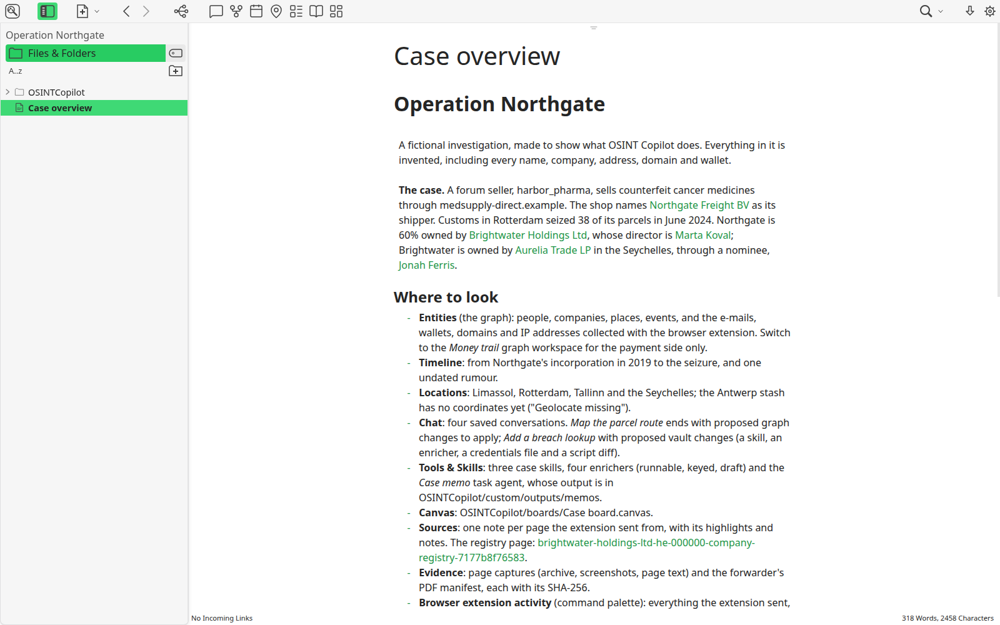

# OSINT Copilot

OSINT Copilot is a local-first investigation workspace for open-source research. It keeps
entities, connections, sources, evidence, timelines, maps, canvases, and working notes in a
folder of Markdown and YAML files that you control.

The desktop application is a fork of [Tangent](https://github.com/suchnsuch/Tangent). Tangent
provides the editor and workspace foundation; OSINT Copilot adds the investigation layer. See
[NOTICE](NOTICE) for attribution and the statement of changes.

## Highlights

- Model people, organizations, assets, events, and relationships with bundled FollowTheMoney-
  shaped schemas or your own types.
- Explore the same records as an entity graph, timeline, locations map, or canvas board.
- Keep source references, evidence files, and confidence assessments beside the claims they
  support.
- Use Claude Code, Codex CLI, Hermes, or a custom local command as an optional chat runtime.
- Build guarded HTTP enrichers, reusable skills, and task agents inside an investigation.
- Capture notes, entities, pages, PDFs, and highlights with the paired Chromium extension.

The included [Operation Northgate demo](demo/README.md) is fictional and exercises the main
workflows.

| Investigation overview | Entity graph |
| --- | --- |
|  |  |
| Timeline | Locations |
|  |  |

## Install

Download the current release from
[OSINT Copilot Releases](https://github.com/OSINT-Copilot/osint-copilot-releases/releases/latest).

| Platform | Packages | Guide |
| --- | --- | --- |
| Windows 10+ | Setup and portable `.exe` | [Windows installation](docs/install/windows.md) |
| Linux | AppImage (x86-64 and arm64), `.deb`, `.rpm` | [Linux installation](docs/install/linux.md) |
| macOS | Build from source; no supported binary yet | [macOS source build](docs/install/macos.md) |
| Chromium browser | Unpacked extension `.zip` | [Browser extension](docs/browser-extension.md) |

The Windows and Linux release binaries are currently unsigned. Check the SHA-256 digest shown
on the GitHub release before running a download.

### Try the demo

1. Install and start OSINT Copilot. No licence key is required.
2. Download `osint-copilot-demo-operation-northgate.zip` from the
   [latest release](https://github.com/OSINT-Copilot/osint-copilot-releases/releases/latest) and
   unzip it, or use `demo/Operation Northgate` from a clone of this repository.
3. Choose **Open a workspace**, select the `Operation Northgate` folder, and open
   **Case overview**.

Everything is free and available in the open-source build. The retained premium infrastructure
is dormant and makes no licence-server request; see [Premium status](docs/premium.md).

## Browser extension

Unzip the extension release into a permanent folder and load it with **Developer mode** from
your browser's extensions page. Then open **Settings → OSINT Copilot → Browser extension** in
the desktop app to pair it. The extension connects only to the app on `127.0.0.1`; it has no
project account, analytics, or remote service. See the [extension guide](docs/browser-extension.md)
and [privacy policy](apps/osint-copilot-extension/PRIVACY.md).

## AI runtimes

AI is optional and no model service is bundled. OSINT Copilot launches a CLI that you install
and authenticate separately. Requests are handled under that provider's terms and may include
investigation material selected for the task. Read [AI runtimes and data flow](docs/ai-runtimes.md)
before enabling one.

## Privacy and data

Investigations stay in the folders you choose, but some features can make network requests:
updates, online map tiles, geocoding, link previews, Wayback lookups, user-configured enrichers,
and AI CLIs. Crash reporting is disabled. The complete list, controls, and local storage paths
are in [Privacy and data](docs/privacy-and-data.md).

## Build from source

Node.js 22 is required.

```bash
git clone --recurse-submodules https://github.com/OSINT-Copilot/osint-copilot.git
cd osint-copilot
npm ci
npm run build:tangent-electron
cd apps/tangent-electron && npm run start
```

The production build bundles and type-checks the whole renderer in one process and needs
roughly 6–8 GB of free memory. On Windows, run the repository scripts from Git Bash or WSL.
See [CONTRIBUTING.md](CONTRIBUTING.md) for development, testing, packaging, and project-layout
details.

## Documentation

- [Install on Windows](docs/install/windows.md), [Linux](docs/install/linux.md), or
  [macOS](docs/install/macos.md)
- [Browser extension](docs/browser-extension.md)
- [AI runtimes](docs/ai-runtimes.md)
- [Updates](docs/updates.md)
- [Privacy and data](docs/privacy-and-data.md)
- [Architecture](docs/architecture.md)
- [Contributing](CONTRIBUTING.md), [security](SECURITY.md), and
  [code of conduct](CODE_OF_CONDUCT.md)

The `Documentation/` directory is the help workspace shipped inside the app. The guides above,
and the maintainer notes such as [Releasing](docs/releasing.md), live under `docs/`.

## Licence and attribution

OSINT Copilot is distributed under the Apache License 2.0. See [LICENSE.txt](LICENSE.txt),
[NOTICE](NOTICE), and [third-party notices](THIRD_PARTY_NOTICES.md).

Built on [Tangent](https://github.com/suchnsuch/Tangent) by Taylor Hadden. Report OSINT Copilot
issues to this repository, not to the Tangent project. The investigation layer grew out of the
[OSINT Copilot plugin for Obsidian](https://github.com/OSINT-Copilot/Obsidian-OSINT-Copilot-plugin).
