# Demo investigation: Operation Northgate

A complete, fictional investigation that uses every part of OSINT Copilot: entities and their sources, the graph, the timeline, the map, a canvas board, saved chat conversations, skills, enrichers, a task agent, and material collected from web pages with the browser extension.

**The people, companies, accounts, and case are invented.** Company identifiers are deliberately invalid, domains use the reserved `.example` top-level domain, and IP addresses come from documentation ranges. Real city and street names are used only to make the fictional map legible; they do not identify a real subject or claim that anything happened at those locations. The wallet addresses are worked examples from the BIP-173 and EIP-55 specifications, and the phone number is from Ofcom's range for drama.

## The case

A forum seller, *harbor_pharma*, sells counterfeit cancer medicines through a web shop, `medsupply-direct.example`. The shop names **Northgate Freight BV** as its shipper, and customs in Rotterdam seized 38 of Northgate's parcels in June 2024. Northgate is 60% owned by **Brightwater Holdings Ltd** (Cyprus), whose director is **Marta Koval**. Brightwater is owned from the Seychelles by **Aurelia Trade LP**, whose only director is a professional nominee.

## Open it

In OSINT Copilot, open the folder `Operation Northgate` as a workspace, then start with **Case overview**.

## What to look at

| | |
|---|---|
| 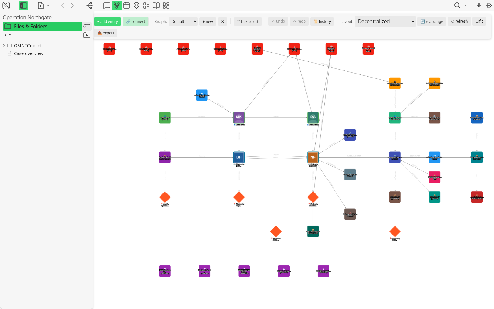 | **Entities** (the graph). People, companies, places, events, and the e-mails, wallets, domains and IP addresses sent from web pages. Every entity is a note in `OSINTCopilot/`, and every connection a note in `OSINTCopilot/Connections/`. Pictures on the nodes come from the entities' `image` property. |
| 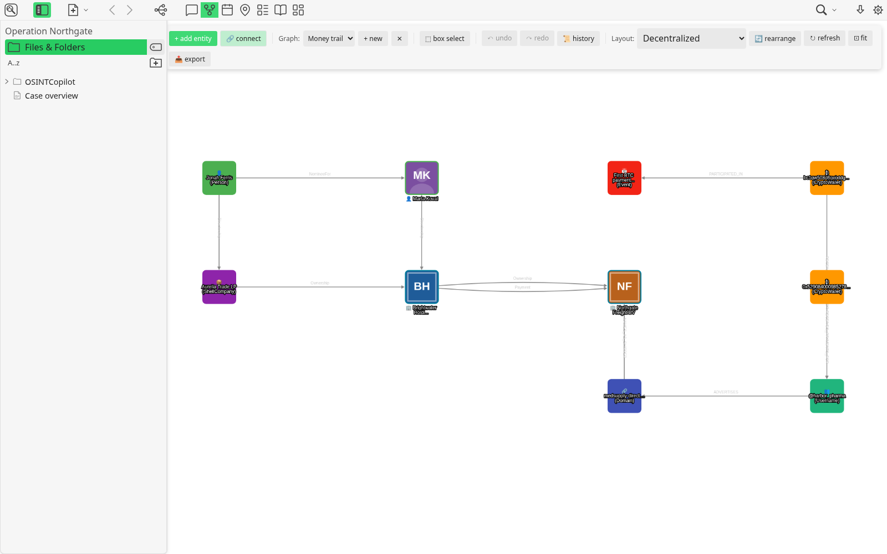 | **Graph workspaces**. Switch the *Graph* menu to *Money trail* for the ownership chain and the payment side only. |
| 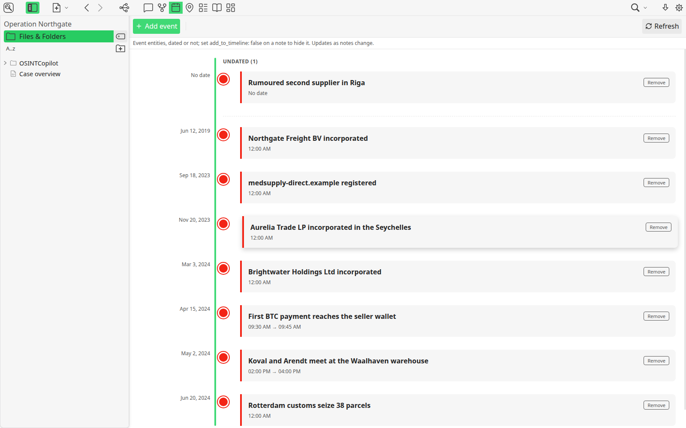 | **Timeline**. Events from 2019 to the seizure, with times where known, and one undated rumour. |
| 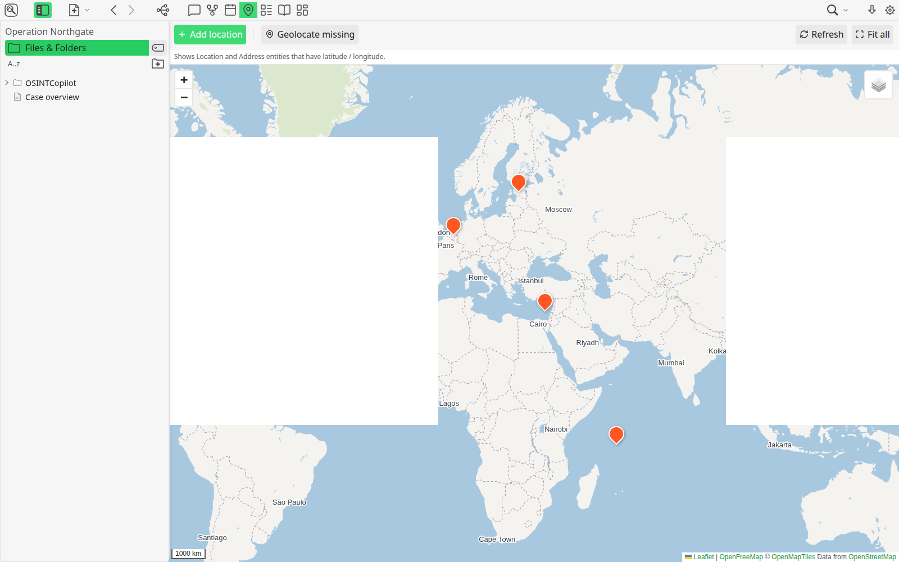 | **Locations**. Limassol, Rotterdam, Tallinn and the Seychelles. The Antwerp stash has no coordinates yet: *Geolocate missing* lists it. |
| 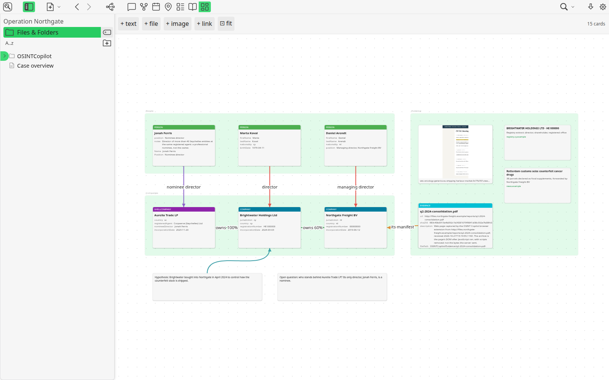 | **Canvas board**. `OSINTCopilot/boards/Case board.canvas`: people and companies as entity cards, the evidence, two web links, and the working hypotheses. |
| 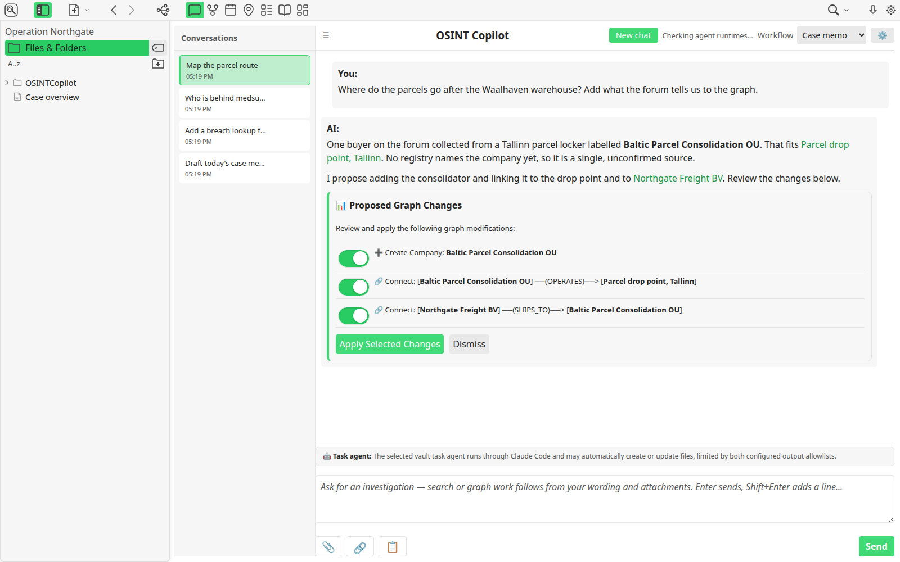 | **Chat**. Four saved conversations. *Map the parcel route* ends with proposed graph changes; apply them to watch the graph grow. *Add a breach lookup* ends with proposed vault changes: a skill, an enricher, a credentials file, and a new version of a script (shown as a diff). |
| 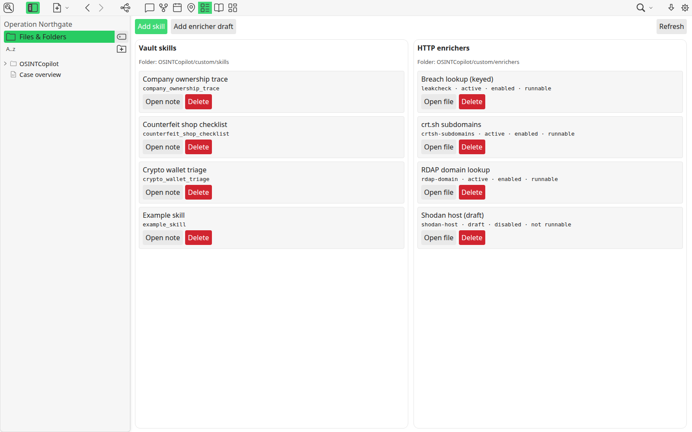 | **Tools & Skills**. Three skills for the case, and four enrichers: three runnable (one of them keyed from the credentials folder) and a draft. The *Case memo* task agent is in `OSINTCopilot/custom/task-agents/`, and the memo it wrote is in `OSINTCopilot/custom/outputs/memos/`. |
| 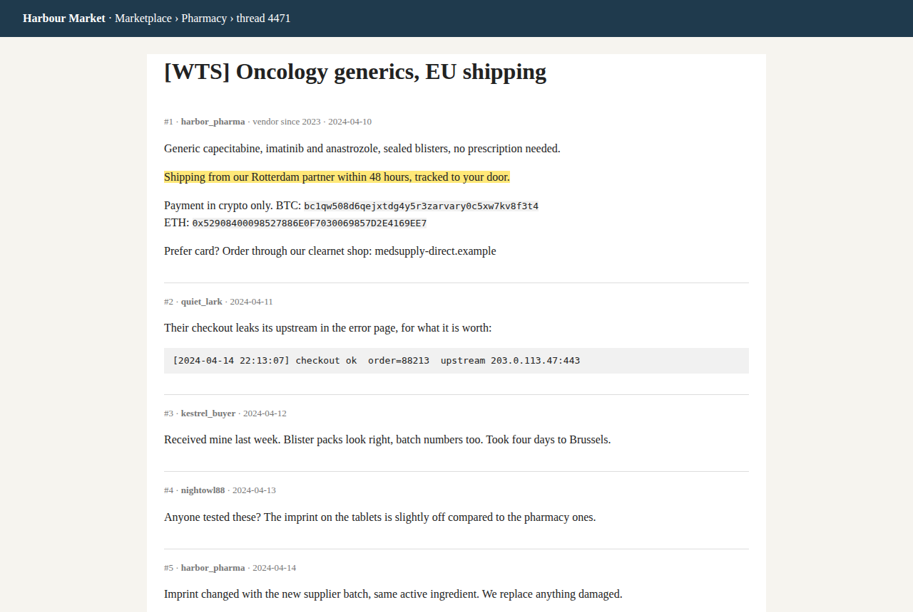 | **The browser extension**. The investigator visited five pages (a forum thread, the shop, a company registry, the forwarder's site and its PDF manifest). From them they sent notes, e-mails, a username, wallets, IP addresses, a phone number, page captures and highlights. |
| 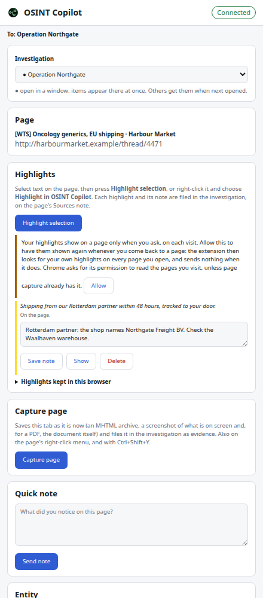 | **The extension's side panel**, paired with the app, filing into *Operation Northgate*, with a highlight and its note. |
| 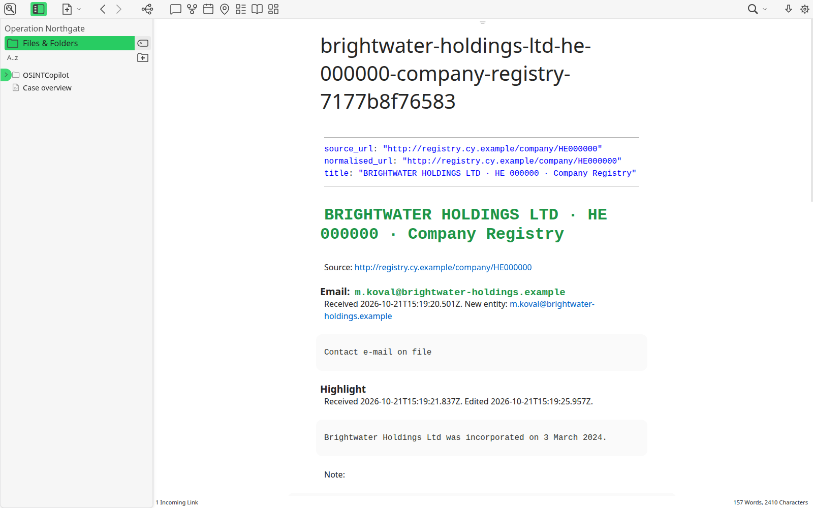 | **Sources notes**. One per page, in `OSINTCopilot/Sources/`, with everything sent from it: highlights and their notes, notes and entities. Each highlight's full description is in the `.annotations.json` file beside the note. On the registry page, one highlight was deleted again, and that file keeps its tombstone. |
| 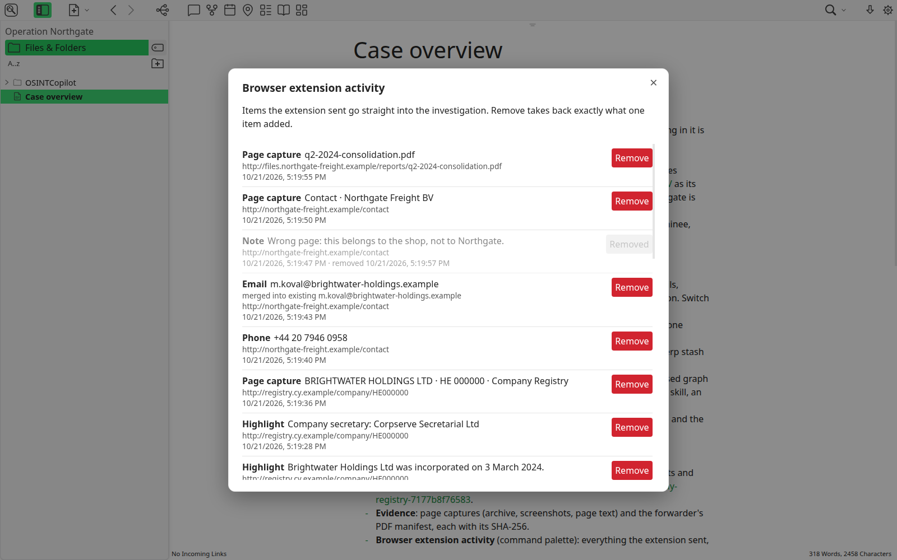 | **Browser extension activity** (command palette). Everything the extension sent, including an e-mail that merged into an existing entity and a note sent from the wrong page and taken back out with *Remove*. |

Also in the workspace:

- **Evidence**, in `OSINTCopilot/Evidence/`: for each page capture, the MHTML archive, a full-page screenshot, what was on screen and the page's text. For the forwarder's report, the original PDF too. Each file has an Evidence entity with its SHA-256.
- **Confidence**, in each entity note's `osint_confidence`, set by its sources. Jonah Ferris is *unverified* (an inference only), Marta Koval *low* (one record), Daniel Arendt *medium*, Northgate Freight *high*, and Brightwater *conflicted*, because two sources disagree on its country.
- **Schema families**: a custom *Shell company* type and a custom *Nominee for* connection (`OSINTCopilot/custom/custom-types.json`), STIX 2 and MITRE ATT&CK entities, and a *Parcel batch* type defined in `OSINTCopilot/schemas/user/case-types.yaml`.
- **Prompts**: case rules in `OSINTCopilot/custom/prompts/rules/global.md`, and a *Case analyst* persona, the active one.

## Limits

- **Extension activity** lists items only on the computer and app profile that built the demo. Each item is sealed with that profile's key. Elsewhere the notes, entities and evidence are all there, but *Browser extension activity* is empty.
- **The map's background** is fetched from OpenFreeMap. Offline, the map shows a coordinate grid instead.
- **New chat messages** need a runtime: the Claude Code or Codex command-line tool, or a custom one. The saved conversations and their proposals need nothing.
- **The enrichers' web services** do not know the fictional domains, so running an enricher on them finds nothing.

## Rebuild it

The demo is made by `apps/tangent-electron/tests-integration/demo/make-demo.demo.ts`. It drives the development build of the app and the real browser extension through the case, and writes every note, entity, connection, capture and inbox item through the app's own code. It deletes and rebuilds this folder, and retakes the screenshots.

```sh
cd apps/tangent-electron
npm run build:dev
npm run demo            # on Linux without a display: xvfb-run -a npm run demo
```

It uses your own OSINT Copilot profile, so that its extension items verify there. The pairing it makes is revoked, and the extension channel switched back off, when it finishes.
